<div align="center">

# YESWIT 档案管理系统

**档案业务管理 · 桌面 Agent · 电子与实体档案协同**

从接收、编目、归档到借阅、鉴定与处置，为组织建立有规则、有权限、有记录的档案工作体系。


[](./LICENSE)

[官方网站](https://www.yeswit.cn) · [申请演示](mailto:admin@yeswit.top?subject=YESWIT%20产品演示) · [使用手册](./docs/system_knowledge_base/01-使用手册.md) · [部署说明](#部署与开发)

</div>

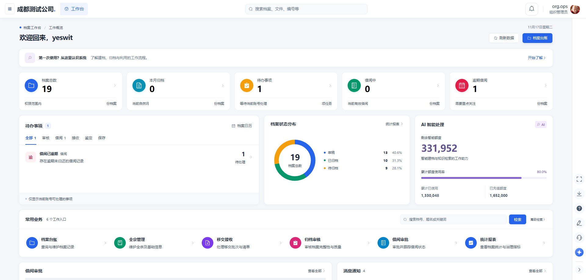

## 产品概览

YESWIT 面向企业、事业单位、学校及集团组织，管理电子档案、实体档案以及二者并存的业务。既可以用于部门档案室，也可以承载多组织、多角色的集中管理。

系统以档案台账为基础，将业务规则、审批流程、文件内容、实体位置和操作记录关联起来。管理人员处理归档与保管，使用人员检索和借阅，桌面 Agent 承接文件分析、批量整理和业务办理，三个入口共用后端服务与权限体系。

| 入口 | 主要用途 | 技术实现 |
| --- | --- | --- |
| Web 管理端 | 基础配置、档案台账、审批、库房、鉴定、统计及平台管理 | Vue 3、TypeScript、Element Plus |
| 桌面端 ArchiveBuddy | Agent 对话与执行、本地文件处理、批量任务；可切换至 Work 管理界面 | Electron |
| 移动端 | 待办审批、查档、扫码、借阅、到期查看与档案助手 | uni-app，提供 Android、HarmonyOS 构建配置 |

## 设计特点

**业务规则可以调整。** 全宗、分类、著录方案、字段、字典、编号与保管规则均有独立配置。归档审批支持多级节点、指定人员、部门负责人和部门匹配规则，便于适配不同组织的档案制度。

**电子档案与实体档案共用台账，各自保留业务流程。** 电子借阅通过审批后授予访问权限；实体借阅还需要确认出库、交接和归还。档案盒、库位、保管记录与文件附件关联到同一档案，便于核对资料在哪里、由谁保管、当前能否利用。

**Agent 执行建立在真实业务结果之上。** 查询和文件分析提供依据，变更先生成待确认方案。建档、修改和办理操作沿用后端业务校验；计划、步骤和回执保留在任务中，便于复核与恢复。

**权限贯穿不同入口。** 租户、角色、数据范围和密级许可共同限定可见内容，档案详情、附件预览、导出与 AI 工具复用相应授权检查。多租户采用逻辑隔离；需要独立基础设施时，可按私有化方案部署。

**核心业务集中在一套 Java 服务中。** Web、桌面和移动端共用业务实现，Agent 编排也运行在现有后端。全文检索、对象存储、文档预览和模型服务按需接入，便于控制部署规模与后续维护成本。

## 档案业务

### 从接收到利用，再到到期处置

| 环节 | 已有能力 |
| --- | --- |
| 基础配置 | 全宗、分类、著录方案与字段、编号规则、保管规则、数据字典、丛编与档案关系 |
| 接收与整理 | 移交接收、批次管理、电子档案四性检测、整理编目、质量检查、Excel 导入、AI 辅助建档 |
| 归档与审核 | 多级审批、退回修改、审批历史、版本记录与差异比较、版本回滚审批 |
| 检索与利用 | 组合查询、全文检索、自然语言检索条件解析、收藏标签、最近访问、利用统计 |
| 借阅与证明 | 电子授权、实体出库、续借、归还确认、催还与逾期处理；档案证明申请、审批与出具 |
| 库房与保管 | 档案盒、库位、上架装盒与移库、条码与 RFID 信息、实体一致性检查、人员出入、温湿度记录与看板 |
| 开放与共享 | 电子分库、开放鉴定、开放目录、公开档案门户；目录开放与附件访问分别管理 |
| 鉴定与处置 | 到期日历、鉴定简报、鉴定小组会签、保留与延期、降密与解密、移交、销毁申请与清册 |
| 长期保存 | 完整性检查、格式迁移任务、源文件与输出文件哈希记录、数字签名与验签、续签及证据包 |
| 管理与统计 | 业务看板、报表、操作审计、消息通知、工单反馈、数据交换导入导出 |

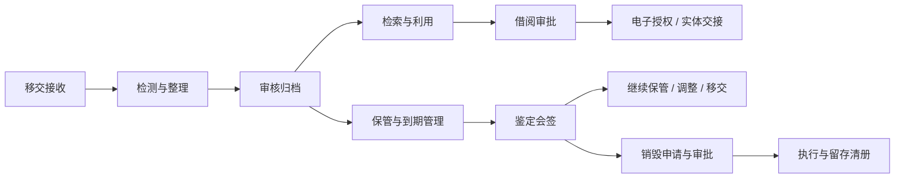

全文检索需要启用 Elasticsearch。温湿度看板基于已登记的数据，也可通过集成接口写入读数。格式迁移支持已接入的转换路径，例如 Office 转 PDF，需配置相应转换服务。

### 管理界面

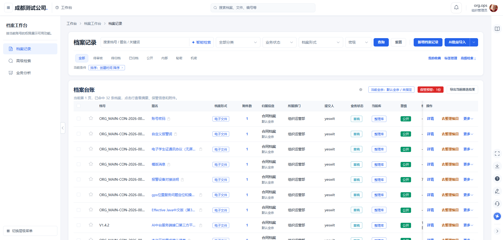

<details>
<summary>查看归档审批、鉴定与库房界面</summary>

**归档规则**：按组织制度配置审批节点与审批人。

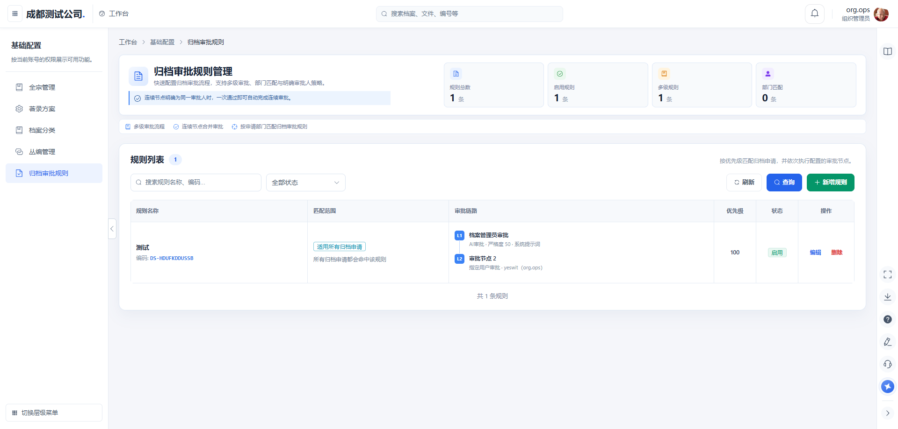

**鉴定管理**：集中跟踪鉴定任务、成员意见与办理进度。

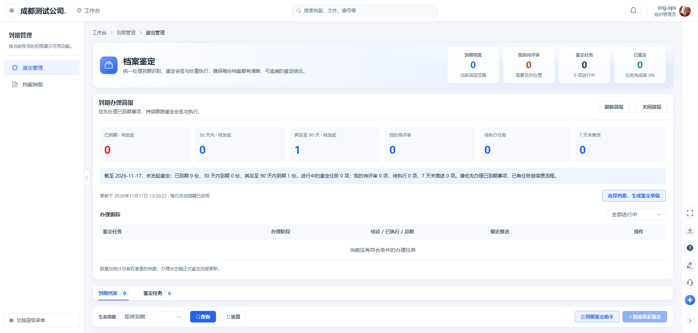

**库房看板**：查看温湿度记录与变化趋势。

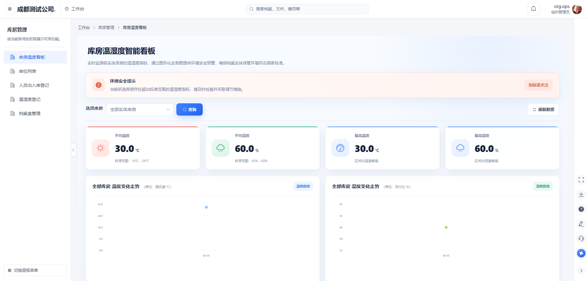

</details>

## 桌面 Agent：从文件到业务操作

ArchiveBuddy 将对话、文件处理和任务执行放在同一个工作区。用户可以先提出目标，再根据查询结果补充条件、编辑方案、确认执行，无需把一次办理拆成多个页面操作。

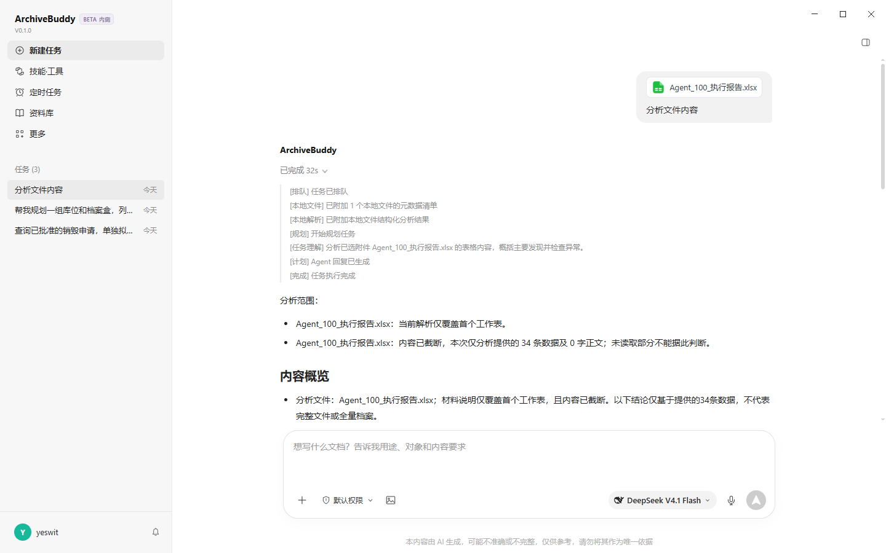

### 可以交给它的工作

| 工作 | 输入示例 | 处理方式 |
| --- | --- | --- |
| 文件内容分析 | “总结这份文件，列出关键日期和需要注意的事项。” | 读取本次授权文件的解析内容，完成摘要、表内统计、逐行解读或异常分析 |
| 批量建档 | “把这个文件夹的材料整理成档案，先给我检查。” | 解析文件，查询可用分类，准备草稿，预检缺项与重复项，确认后建档并处理附件 |
| 台账比对 | “比较这份 Excel 和系统台账，列出差异，准备修改方案。” | 查询可见档案并比对真实数据，展示匹配候选与差异，再准备更新或补建方案 |
| 到期办理 | “查一下到期档案，准备鉴定方案供我确认。” | 查询到期情况、已有任务和可选成员，依据结果准备方案；无可办理对象时说明结果 |
| 日常管理 | “登记一次库房人员出入。” | 查询真实人员、库位等候选，补齐必要信息，确认后登记 |
| 结果交付 | “生成本次任务的执行报告和错误清单。” | 从已保存的工具结果生成文件，集中放入资料库供查看和下载 |

### 查询、方案和执行分别留痕

任务先解释目标和范围，再读取文件或查询业务数据。需要变更时，展示可编辑的待确认方案；用户确认后，后端按相应权限和业务规则执行。技术销毁等敏感操作设有独立确认边界。

执行过程按对话轮次展示计划、步骤、结果与耗时。任务支持暂停、恢复、取消和失败重试，已成功步骤保留；服务端持久化计划和执行状态，并通过版本校验、幂等与执行租约控制重复提交和恢复执行。补充回复不会自动批准业务写入。

资料库汇总任务产物，包括执行报告、错误清单、操作记录和相关导出文件。字段修改记录可查看修改前后内容，业务完成情况以实际工具回执为依据。

### 定时运行

支持单次、每天、工作日和每周调度，可指定模型与时区，查看每次运行记录。例如定期查看到期档案、汇总借阅逾期或生成业务简报。

调度由服务端执行，关闭桌面客户端后仍可运行，后端与数据库需要保持在线。业务写入仍需确认；上一次任务尚未结束或正在等待确认时，后续触发会跳过。工作日指周一至周五，暂不包含法定节假日规则。定时任务不会自动读取本机文件。

<details>
<summary>查看 Agent 新建任务、资料库与定时任务界面</summary>

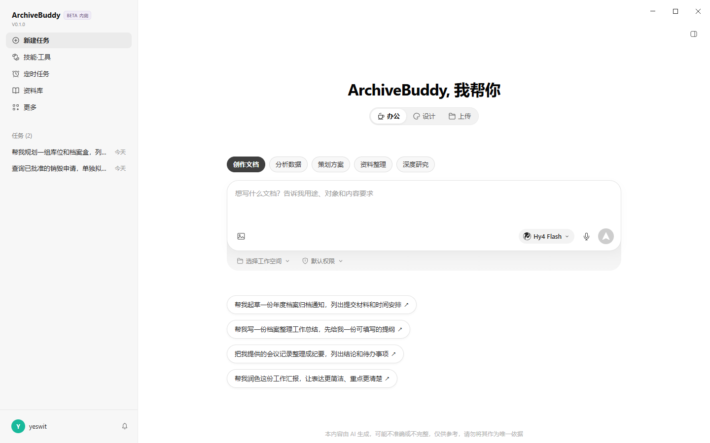

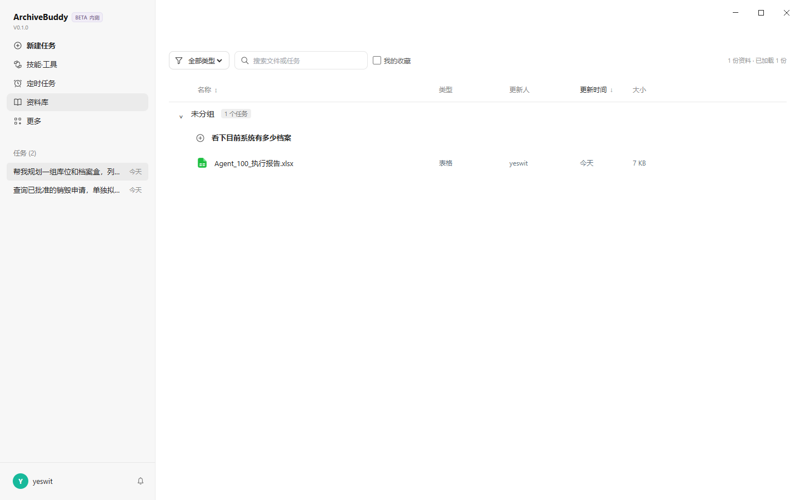

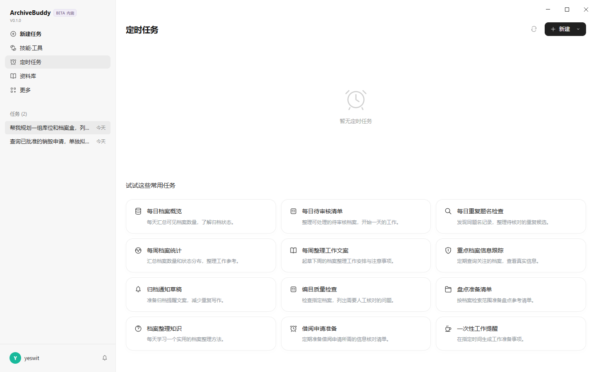

</details>

### 文件与模型边界

桌面端支持 TXT/Markdown、CSV/XLSX、PDF、DOC/DOCX，以及 PNG、JPEG、BMP、TIFF 图片；文本提取与中英文 OCR 在本机完成。用于任务的有限解析内容会发送到后端及所选模型，调用外部模型时应按组织的数据政策选择服务与文件范围。

当前 XLSX 解析覆盖首个工作表，表格预览最多 100 条数据、30 列，单元格最多 300 字符；文档提取正文最多 12,000 字符。超出范围会标记截断，内容分析不能视为全文件审阅，截断数据也不能直接用于完整写入。无文本层的扫描 PDF 需先转成图片进行 OCR，旧版 XLS 需转为 XLSX 或 CSV。

## AI 与模型管理

Web 与移动端提供智能建档、档案问答、检索辅助和业务解释；桌面 Agent 进一步提供文件任务、分步执行与写入确认。系统功能及操作说明问答可检索已发布的系统知识库。

模型服务已接入**阿里云百炼、DeepSeek、腾讯 TokenHub**，包括 Qwen 系列及腾讯 `hy4-flash`、`hy4`。管理员可配置模型、能力、业务场景绑定与用量规则；图文输入取决于所选模型支持的能力。

Agent 桌面端模型默认开启模型思考模式。模型输出还需经过协议、业务对象来源和工具参数校验；思考模式会增加部分调用耗时与 Token 消耗。平台可查看智能用量与额度流水，并按部门分配 AI 额度。

## 移动办公

移动端聚焦外出和现场工作：处理待办、查询档案、扫码查档、申请借阅、查看详情和到期信息。与 Web 共用账号及授权，适合库房巡查、现场核对和移动审批。

<div align="center">
  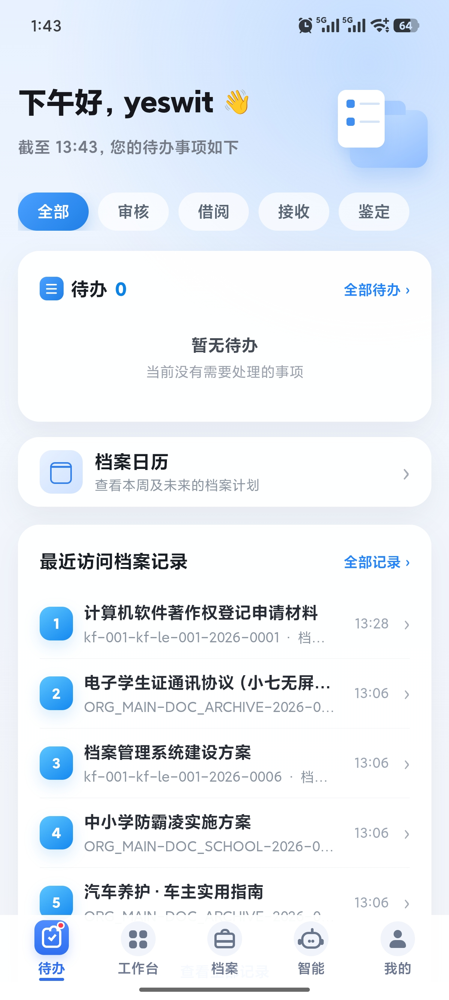
  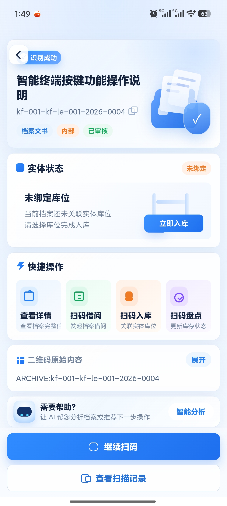
  
</div>

## 权限、审计与系统集成

| 层面 | 机制 |
| --- | --- |
| 组织与账号 | 平台与租户管理，部门、用户、角色、菜单和按钮权限；支持企业微信登录与绑定 |
| 档案访问 | 租户范围、部门及本人数据范围、密级许可，结合借阅授权控制利用 |
| 文件访问 | 预览访问校验、短期 Token、URL 签名与水印；下载与导出分别检查权限 |
| 过程追踪 | 登录与操作日志、审批历史、档案版本、Agent 计划和执行回执 |
| 对外接口 | API Key、权限范围、来源系统、IP 白名单、限流、有效期与密钥轮换 |
| 平台运营 | 租户、套餐订阅、资源配额、订单、智能用量、通知与工单 |

业务集成接口支持基础数据查询、单条与批量归档、来源系统记录查询、档案状态查询及库房温湿度登记。请求可结合 HMAC 签名、时间戳与单条归档幂等键，接入 OA、ERP、HR 或其他业务系统时可保留来源标识，便于追踪。

技术销毁会处理在线附件对象、搜索索引及相关缓存，并留存执行清单。备份、副本和对象历史版本的清理需要配合部署环境的保留策略，不能仅凭业务系统的销毁状态判断所有副本均已清除。

## 技术架构

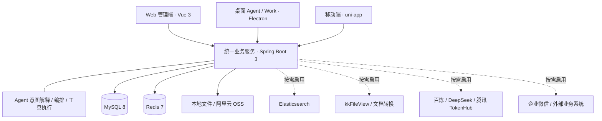

| 模块 | 主要技术 |
| --- | --- |
| 后端 | Java 17、Spring Boot 3、MyBatis Plus、WebSocket、OpenAPI |
| Web | Vue 3、TypeScript、Vite、Element Plus、Pinia |
| 桌面 | Electron、Markdown 渲染与净化、本地文件解析、Tesseract.js OCR |
| 移动 | uni-app、HBuilderX |
| 数据与文件 | MySQL 8、Redis 7、本地存储或阿里云 OSS、可选 Elasticsearch |
| 文档处理 | Apache Tika、Apache POI、PDFBox、kkFileView |
| 部署 | Docker Compose、Nginx、环境变量配置 |

### 仓库结构

```text
archive/
├─ backend/                     # 业务服务、Agent 编排与工具、数据库脚本
│  └─ src/main/resources/db/     # 数据库基线与增量迁移
├─ pc/
│  ├─ frontend/                 # Vue Web 管理端
│  └─ agent/                    # ArchiveBuddy 桌面端、文件解析与打包
├─ mobile/                      # uni-app 移动端
├─ docs/                        # 产品资料、操作手册、部署与验收文档
├─ deploy/                      # 部署辅助配置
├─ docker-compose.yml
├─ .env.example
└─ LICENSE
```

## 部署与开发

### 部署准备

支持 SaaS 使用和私有化部署。自行部署时，基础服务为 MySQL 8、Redis 7 和 Java 后端；Web 由 Nginx 等静态服务器提供，桌面与移动端连接同一服务。按实际需求配置文档预览、搜索、对象存储和模型接口。

首次部署先核对域名与 HTTPS、数据库和文件存储位置、初始管理员凭据及预览回源地址。数据库使用基线 SQL 与按版本执行的增量迁移，**当前没有自动运行 Flyway**，升级前应备份并核对迁移范围。

仓库提供 [Compose 编排](./docker-compose.yml)、[环境变量示例](./.env.example) 和部署脚本。当前前端目录已迁至 `pc/frontend`，使用编排前需将 `frontend.build.context` 从 `./web` 调整为 `./pc/frontend`。可选服务的开关和凭据需显式传入后端容器；仅写入 `.env` 不会自动启用或注入全部配置。

完整步骤见[从空服务器部署](./docs/01-从空服务器部署.md)、[环境变量清单](./docs/02-环境变量清单.md)与[运维手册](./docs/05-运维手册.md)，执行时以当前目录和配置为准。

### 本地开发

准备 Java 17、Maven 3.9+、Node.js 20+、MySQL 8 和 Redis 7，初始化数据库并按所用版本执行迁移，再配置后端数据库、缓存、文件目录和管理员凭据。

后端：

```bash
cd backend
mvn spring-boot:run
```

Web 管理端，另开终端：

```bash
cd pc/frontend
npm ci
npm run dev
```

开发环境默认后端端口为 `8080`，Web 为 `5174`。启用 OpenAPI 后，可通过 `/swagger-ui/index.html` 查看接口文档，规范地址为 `/v3/api-docs`。

<details>
<summary>桌面与移动端开发</summary>

桌面开发先在 `pc/frontend` 安装依赖，再执行：

```bash
cd pc/agent
npm ci
npm run dev
```

该命令会同时启动 Web 开发服务和 Electron，与上面的 Web 启动方式二选一，避免占用同一端口。构建桌面分发包使用 `npm run dist`。

移动端使用 HBuilderX 打开 `mobile/`，配置服务地址及对应平台签名。参见[移动端构建与签名](./docs/06-移动端构建与签名.md)。

</details>

## 文档导航

| 面向对象 | 文档 |
| --- | --- |
| 使用人员 | [使用手册](./docs/system_knowledge_base/01-使用手册.md) · [业务操作流程](./docs/system_knowledge_base/03-操作流程.md) · [常见问题](./docs/system_knowledge_base/02-常见问题.md) |
| 部署与运维 | [从空服务器部署](./docs/01-从空服务器部署.md) · [环境变量](./docs/02-环境变量清单.md) · [运维手册](./docs/05-运维手册.md) |
| 开发与集成 | [数据库与迁移](./docs/03-数据库设计与迁移规范.md) · [API 与 Swagger](./docs/04-API与Swagger.md) · [账号角色与权限](./docs/07-账号角色与权限模型.md) |
| 桌面与 AI | [桌面端说明](./pc/agent/README.md) · [Agent 回归验证](./docs/Agent回归测试.md) · [腾讯 TokenHub 接入](./docs/腾讯TokenHub接入.md) |
| 交付与验收 | [验收与版本记录](./docs/08-验收测试与版本记录.md) · [第三方许可证与 SBOM](./docs/09-第三方依赖许可证与SBOM.md) |

## 商业交付与许可

YESWIT 采用商业许可，可根据组织规模与交付要求选择 SaaS 订阅、私有化部署、源码授权或定制集成。套餐、配额、交付范围与维护服务以正式方案和合同为准。

许可方为**贵阳市南明区霖化软件部（个体工商户）**。仓库展示不等同于开源授权；源码阅读、修改、部署及二次开发的权利按授权合同约定，第三方组件遵循各自许可证。完整条款见 [LICENSE](./LICENSE)。

申请演示或评估方案时，可说明组织类型、使用人数、档案规模、电子与实体档案比例、部署环境以及需要对接的业务系统。

- 官方网站：[www.yeswit.cn](https://www.yeswit.cn)
- 商务邮箱：[admin@yeswit.top](mailto:admin@yeswit.top)

<details>
<summary>微信咨询</summary>


</details>
